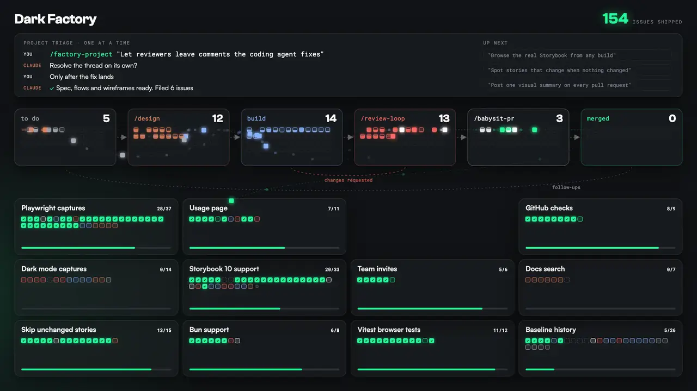

# factory

<p align="center">
  
</p>

GitHub issues in, reviewed pull requests out. A dark factory that runs on your Mac with Claude Code.

You write GitHub issues. Every 10 minutes a plain Node script (the **tick**, run by macOS `launchd`, no model in the loop) reads your issues, your PRs and your running Claude Code sessions. For each issue that is ready it starts a background Claude Code worker (`claude --bg`) in its own git worktree. The worker designs the change when it needs one, builds it, has Claude and Codex review it until the review comes back clean, tests it, opens a pull request and looks after it until CI is green. You review and merge. A worker never asks you anything in a chat: when it hits a question only you can answer, it writes the question on the issue and stops, and your reply on the issue starts it again.

## Built with UI Verify

<a href="https://uiverify.ai/?utm_source=github&utm_medium=readme&utm_campaign=factory">
  <picture>
    <source media="(prefers-color-scheme: dark)" srcset="docs/uiverify-wordmark-dark.svg">
    
  </picture>
</a>

Running a bunch of agents at once? [UI Verify](https://uiverify.ai/?utm_source=github&utm_medium=readme&utm_campaign=factory), a new project by
the author of this factory, makes sure your UI doesn't break while they ship. Your
coding agent sees every UI change it makes, so visual bugs never reach production.

This factory builds UI Verify itself: the workers use it to see what their changes
did to the screen and fix what broke before the pull request reaches me.

[What UI Verify is](https://uiverify.ai/?utm_source=github&utm_medium=readme&utm_campaign=factory)
· [Add its skills to your agent](https://github.com/uiverify/uiverify): `npx skills add uiverify/uiverify`

## How an issue moves

| Step | Who | What happens |
|---|---|---|
| 1. Plan | You | Write issues, or run `/factory-project` to turn an idea into a spec, flows and wireframes, and a batch of issues in build order. |
| 2. Queue and triage | The tick | Each new issue in a target gets one verdict from a short triage run: `ready`, `split`, `decide`, `human` or `later`. |
| 3. Build | A worker | Its own worktree and branch. `/design` when the change needs it, then code and tests. |
| 4. Review | The worker | `/review-loop` (Claude and Codex) until clean, `/e2e-verify` when the change has a surface tests cannot cover, then your repo's local checks. |
| 5. Pull request | The worker, then babysit passes | Opens the PR. When CI fails, a conflict appears or someone comments, the tick wakes it to fix and answer. |
| 6. Merge | You | A green, mergeable PR gets you a notification. You merge. |
| 7. Done | The tick | The issue closes through `Fixes #n`. The tick removes the session, the worktree and the factory labels. |

A repo can also skip the PR and have workers land reviewed commits straight on its base branch, or collect a whole project on one long-lived branch that ends in a single PR.

## Before you start

**This is not plug and play.** It is one person's working setup, published as is. Expect to spend a couple of days making it fit your workflow: writing the principles files, choosing how each repo ships, and getting your repo's tests, lint and `CLAUDE.md` to the point where they catch what a reviewer would. Start with one target, one or two issues in flight, and every change going through a PR you merge.

- **Workers run with no permission prompts** (`--dangerously-skip-permissions`, and `bypassPermissions` in each worktree). A worker can run any command as you, with your credentials. Run it only on a machine and accounts where that is fine.
- **macOS, Claude Code and GitHub only.**
- **It is only as good as your repo.** The factory runs the loop; your repo supplies the judgment.
- **It uses your Claude subscription.** Several Opus sessions at once is heavy. See [What does it cost?](#what-does-it-cost)

## Make it yours

These are the parts you will most likely change, and where they live.

| What | Where |
|---|---|
| **The ticket system** | It runs on GitHub issues through `gh`, and the issue state lives on the issues (labels plus one state comment each). It is not one swappable module. Reading issues is in `lib/common.mjs` (`fetchRepoIssues` and the label and comment helpers). Writing labels and comments is in `bin/factory-tick.mjs`. The dashboard runs its own queries in `bin/factory-dashboard.mjs`. The agents also call `gh` themselves, following `issues.md` and the skills `factory-triage`, `factory-auto`, `factory-project`, `factory-monitor` and `factory-ops`. Moving to Jira or Linear means changing all of those. PRs and CI stay on GitHub either way. |
| **Where the code lives** | `repos` in `factory.json`: the GitHub slug, your local clone, the base branch, a branch prefix and a setup command per worktree. `targets` choose which issues the factory works on: a batch parent's sub-issues, a set of labels, or both, plus a one-line scope rule. |
| **Who merges** | `ship` per repo: `pr` (workers open PRs, you merge) or `push` (workers land on the base branch). A target can use `ship: "branch"` for one long-lived branch and one PR. `merge_window` lets babysit merge green, reviewed PRs itself until a date you set. Say why in `ship_why`; every worker prompt repeats it. |
| **Cost** | `workers.max_concurrent` (workers at once), and per target `max_in_flight` and `max_awaiting_review` (new work stops while that many PRs wait on you). Also the worker model and effort, `plugins` (each enabled plugin costs every session tokens), `triage.max_per_tick` and `babysit.heartbeat_hours`. The handoff thresholds are constants at the bottom of `lib/common.mjs`. |
| **Models** | Workers: `workers.model` and `workers.effort`, overridden per repo (`worker_model`, `worker_effort`) or per target. Triage and planning: `triage.model`, `planner.model`. The monitor: `bin/install-launchd.sh`. The design critics and code reviewers (Claude plus Codex when it is installed and logged in) are set in `skills/design` and `skills/review-multi-model`. A worker not on Opus asks an Opus subagent before product calls and before parking. |
| **The rules workers follow** | `principles/common.md` (every repo), `principles/<repo>.md` (one repo, started from `principles/TEMPLATE.md`), then the repo's own `CLAUDE.md`. The fastest way to write them: look at the questions your agents asked you last month. Every question you answered the same way twice is a rule. A repo can also carry its own versions of the loop skills in `.claude/skills/`; workers use those first. |
| **The dashboard** | `bin/factory-dashboard.mjs`, one file with no dependencies. Ask `/factory-ops` to change it. |

## Parking

A worker decides anything a later commit can undo (names, which helper to reuse, test strategy, copy inside an agreed UX) and lists each choice under **Decisions taken** in the PR, so you can overrule them in one pass. It stops only for the reasons in `principles/common.md`: something irreversible or outside the repo, a contradiction with the issue or a recorded decision, a wrong premise, a product fork users would notice, or a step only you can do.

To stop, it **parks**: one question comment on the issue with 2 to 4 options and its recommendation, the `factory: needs info` label, and the session ends. You get a macOS banner (and a webhook message if you set one). Answer with a plain comment on the issue, and the next tick resumes the worker with your words. Other issues keep moving.

A worker that runs out of Claude usage is not parked: the tick waits for the reset. A worker that keeps crashing is resumed up to `max_restarts` times, then parks with a question.

## Who does what

| Who | Does |
|---|---|
| **You** | Write issues or plan with `/factory-project`. Start and stop with `/factory-run`. Answer parked questions and pick an option on `decide` issues, by commenting. Do the steps only you can do. Review and merge. Set `priority: high` to put an issue first. |
| **The tick** | Plain Node, every 10 minutes. Creates the labels, runs triage, groups ready issues into packages, starts workers in worktrees, resumes dead or parked workers, wakes babysit passes, notifies you, cleans up. Holds all agent work while the Claude usage limit is hit. Never writes code. |
| **Workers** | One `claude --bg` session per package of issues, running `/factory-auto`: design, build, review, verify, then a PR or a push. Records its decisions, parks on a real question, hands off to a fresh session when its context gets large. |
| **Babysit passes** | The same worker session, woken with `/babysit-pr` when its PR changes (or every `heartbeat_hours`). Fixes CI and conflicts, answers review comments, then ends. |
| **Triage** | A short headless `claude -p` run per new issue. Returns a verdict, writes a `## Verify` checklist into ready issues, splits big ones into sub-issues. |
| **The monitor** | `/factory-monitor` every 30 minutes, read-only. Catches the loop quietly doing nothing (a green PR nobody announced, a "busy" worker that had finished) and tells you about new problems only. |

Everything the factory posts on GitHub goes out under your own `gh` login.

## Guardrails

Workers run unattended with permission prompts off, so it matters which rules are enforced and which are only instructions.

- **It never merges or approves.** Every worker and babysit prompt says so, unless you opened a `merge_window` for that repo.
- **It stops starting work when you fall behind.** `max_awaiting_review` holds a target's new work while that many PRs wait on you.
- **Rules ship separately.** A new or changed rule (a lint guard, a `CLAUDE.md` line) goes in its own PR for you to decide, never inside feature work.
- **These are instructions, not hooks.** The factory's own two hooks (`worker-settings.json`) only manage long sessions: one asks a worker past 500k tokens of context to hand off, the other starts the next tick right after a handoff. If you want hard blocks (no push to your main branch, no force push, no `gh pr merge`), add `PreToolUse` hooks to your repo's `.claude/settings.json`. Workers run in worktrees of your repo, so Claude Code loads them there too.

## The skills

All in [`skills/`](skills), linked into `~/.claude/skills/` by `setup.sh`.

**The loop** (the same skills as UI Verify's [`uiverify-workflow`](https://github.com/uiverify/uiverify/tree/main/packages/workflow-skills) plugin). A repo can carry its own versions in `.claude/skills/`; workers use the repo's when it has them.

| Skill | What it does |
|---|---|
| `factory` | one change from ask to shipped: design if needed, implement, review, verify, then a PR or a push |
| `design` | drafts a design and has two models critique it until it holds up |
| `review-loop`, `review-multi-model` | Claude and Codex review the diff, verified fixes get applied, repeat until clean |
| `e2e-verify` | drives the change through the real app with Playwright |
| `babysit-pr` | watches CI and review comments on a PR and fixes what fails |
| `add-rule` | turns a correction into a CLAUDE.md rule plus a lint guard, so it never happens again |
| `evaluate-run` | grades a finished run against your conventions |

**The factory** (what runs it unattended):

| Skill | What it does |
|---|---|
| `factory-auto` | `factory` with no questions: decides, records each choice under "Decisions taken", parks on the issue only for the stop reasons |
| `factory-triage` | reads a new issue: ready, split into a batch, needs a decision, needs a human, or later |
| `factory-plan` | groups ready issues into work packages, one worker each |
| `factory-project` | the one place you spend real time: spec, low-fidelity flows and wireframes, architecture and the issue batch, together |
| `factory-run` | start, stop, pause, status, add a repo or a target, in plain words |
| `factory-monitor` | read-only health check every 30 minutes, tells you when the loop quietly stalls |
| `factory-ops` | an operator session: loads how the factory works, checks its health, helps you change it |

For visual testing, add [UI Verify](https://uiverify.ai/?utm_source=github&utm_medium=readme&utm_campaign=factory)'s skills (see [Built with UI Verify](#built-with-ui-verify)): `npx skills add uiverify/uiverify`. When they are installed, the loop uses three of them on any change that touches UI:

| When | UI Verify skill | What it does |
|---|---|---|
| While building | `making-ui-changes` | reuse before you create, cover every state, check what else the change touches |
| Before the PR | `check-visual-changes` | `uiverify check` renders only the stories and pages the worker touched and compares them with your CI baseline |
| On the PR | `triage-visual-changes` | sorts CI's visual changes into regressions and intended changes, fixes the first and accepts the second |

## Install

You need macOS, Node 20 or newer, [Claude Code](https://claude.com/claude-code), `gh` signed in with `repo` scope, and git. Codex is optional; without it, a second Claude reviewer takes its seat.

```sh
git clone https://github.com/uiverify/factory ~/.claude/factory
cd ~/.claude/factory && sh bin/setup.sh
```

Then edit `factory.json`: your name and GitHub login under `owner`, each repo (GitHub slug, local clone, base branch, ship mode) and one target. Rerun `setup.sh` to get a `principles/<repo>.md` per repo and fill it in. Those files are the important part: they are the judgment workers use instead of asking you. Finally, add `@~/.claude/factory/issues.md` to each repo's `CLAUDE.md` so every agent there, factory or not, follows the same issue flow.

Try one tick without side effects, then start it:

```sh
node bin/factory-tick.mjs --dry-run --verbose
sh bin/install-launchd.sh 600        # or /factory-run start in Claude Code
```

That installs three launchd jobs: the tick every 10 minutes, the dashboard at http://localhost:7788, and the monitor every 30 minutes.

## Questions

### Why didn't it pick up my issue?

Usually one of these:

- **It is not in an active target.** It needs every label the target lists, or to be a sub-issue of the target's batch, and none of its `exclude_labels`. A paused target is skipped. A batch named by one target is never taken by a labels-only target.
- **It was already triaged.** Triage looks at an issue once. A `factory: later`, `decide`, `human` or `split` label stays until you change it; swap it for `factory: ready` to hand the issue over. Batch parents are never built.
- **It is blocked.** An open "blocked by" issue holds it, unless the target has `stack: true` and the blocker has one green PR to build on.
- **There is no free slot.** `workers.max_concurrent`, the target's `max_in_flight`, or `max_awaiting_review` (too many PRs waiting on you).
- **The Claude usage limit was hit.** The tick does no agent work until it resets.

`node bin/factory-tick.mjs --dry-run --verbose --only=<target>` prints what the tick would do and why. Or ask `/factory-ops`.

### What does it cost?

It runs on your Claude subscription, and Codex on your ChatGPT plan when it is installed. There is no fixed price per issue: each worker is a full Claude Code session that designs, builds and runs several review rounds. The dashboard's **Usage** page shows the live weekly allowance and the share each issue and each of your own sessions spent. To spend less: fewer workers at once, a smaller `max_in_flight`, workers on Sonnet for a repo or a target, fewer plugins enabled for workers. There is no percentage cap: the tick holds new work only once Claude's usage limit is actually hit.

### Can I watch a worker?

Yes. The dashboard's **Now** page shows each worker's step in the loop, context size, latest messages and an estimate of when it finishes. `claude agents` lists the sessions, and `claude attach <id>` opens one. The tick's own log is `state/tick.log`.

### What if I close my laptop?

Nothing runs while the Mac sleeps, and that is not a fault. When it wakes, the next tick carries on: a worker whose session died or froze is resumed where it was. A shell call that hangs after sleep fails that one tick instead of freezing the loop.

### Where is the detail?

How it works in depth, one tick step by step, every config key and the known quirks: [docs/how-it-works.md](docs/how-it-works.md).

MIT licensed.
